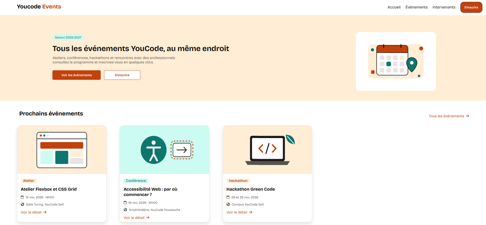

# YouCode Events



Site web fictif présentant les événements de YouCode (ateliers, conférences,
hackathons, rencontres) et permettant de s'y inscrire. Il est responsive
et conçu en mobile-first.

## Fonctionnalités

- Page Événements : liste des événements sous forme de cartes
- Page Intervenants : présentation des intervenants et partenaires
- Page Inscription : formulaire d'inscription
- Style CSS responsive : le site s'adapte au mobile, à la tablette et au desktop

## Technologies utilisées

- HTML5 sémantique
- CSS3 (Flexbox, Grid, media queries)
- JavaScript
- Git, GitHub, Figma, Jira

## Structure du projet

```
youcode-events/
├── index.html
├── evenements.html
├── intervenants.html
├── inscription.html
├── css/
│   ├── style.css
│   └── responsive.css
├── js/
│   └── menu.js
├── assets/
│   └── images/
└── README.md
```

## Workflow Git

- `main` : branche principale, contient la version stable du projet
- `develop` : branche d'intégration, on y fusionne les fonctionnalités avant de passer sur `main`
- `feat/index` : page d'accueil
- `feat/evenement` : page Événements
- `feat/interv` : page Intervenants
- `feat/inscription` : page Inscription

## Démo en ligne

🔗 [Voir le site en ligne](https://itsemmax.github.io/YouCode-Events/index.html)